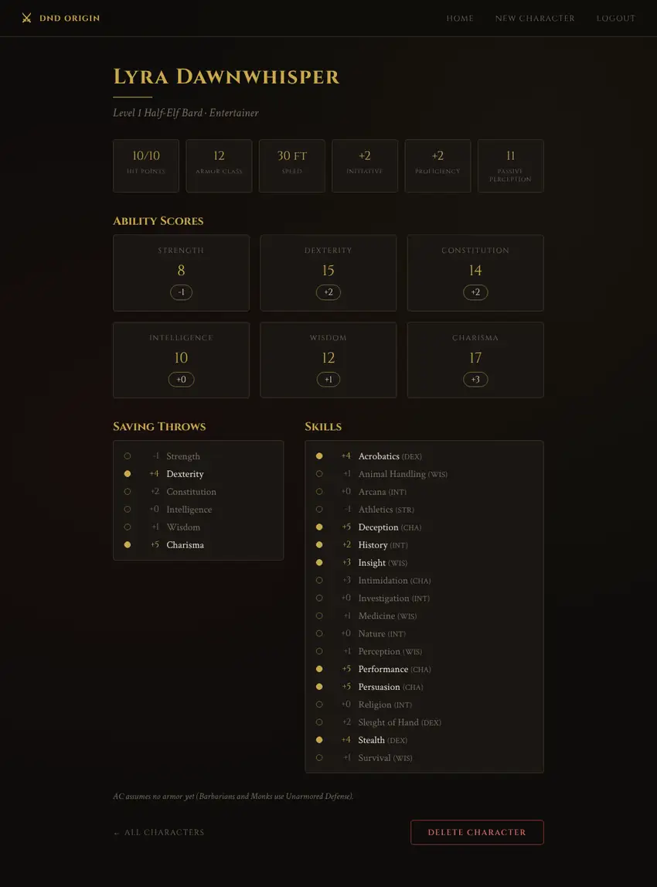
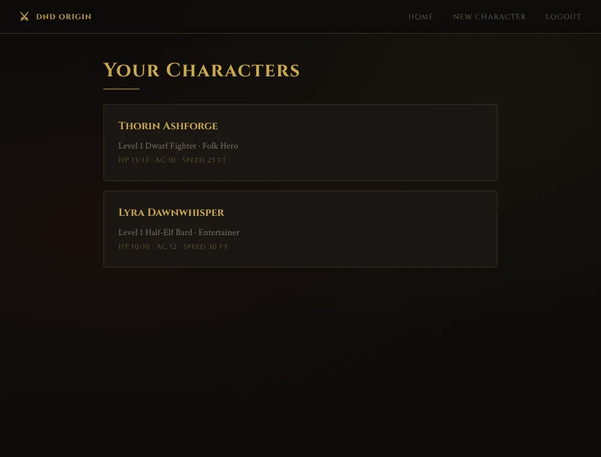
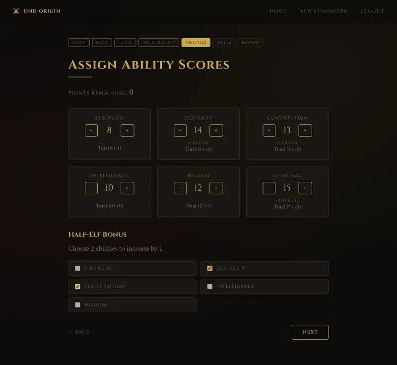
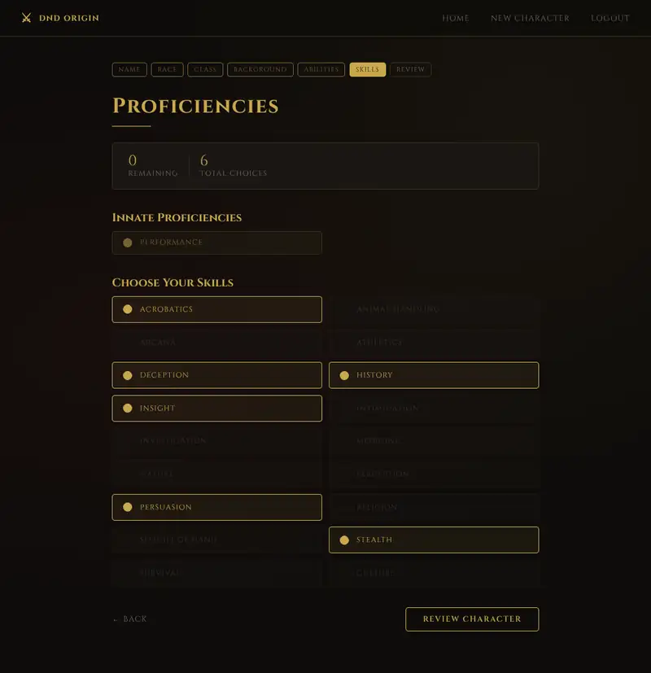

# DnD Origin

A web-based **Dungeons & Dragons 5th Edition character creator** built with Python, Flask and SQLite. It walks you through making a level 1 character step by step (name, race, class, background, ability scores and skills), applies the 5e rules along the way, and saves a finished character sheet to your account.



## Features

- **Accounts**: register and log in. Passwords are stored as hashes, and every user only sees their own characters.
- **Seven-step creation wizard**: Name → Race → Class → Background → Ability Scores → Skills → Review. It has a progress bar and Back buttons, and remembers your choices if you go back.
- **Point-buy ability scores**: the official 27-point system (scores 8 to 15, where 14 and 15 cost extra). The page adds racial bonuses live, including the Half-Elf's two free +1s.
- **Skill proficiencies**: skills granted by your race, class and background are added automatically. You then pick the rest, and the counter locks the list when you run out of picks.
- **Calculated character sheet**: HP, Armor Class, speed, initiative, proficiency bonus, passive perception, ability modifiers, saving throws and all skill modifiers.
- **Character management**: view any saved character's sheet, or delete it.
- **Server-side validation**: every rule enforced in the browser is checked again on the server. That covers point-buy totals, the number of skills and valid race/class/background names.

## Screenshots

| Your characters | Ability scores |
|---|---|
|  |  |

| Skill selection |
|---|
|  |

## Tech Stack

- **Backend**: Python 3 / Flask. All the routes and the rules logic are in `app.py`.
- **Database**: SQLite through Python's built-in `sqlite3` module. The schema is in `schema.sql`.
- **Sessions**: Flask-Session, which stores sessions on the server (in the `flask_session/` folder through cachelib).
- **Frontend**: Jinja2 templates and a hand-written `style.css` (no CSS framework), with a little plain JavaScript for the point-buy calculator and skill picker.
- **Data**: local JSON files with D&D data for races, classes and backgrounds, loaded into memory when the app starts.

## Getting Started

You need Python 3.9 or newer.

```bash
git clone https://github.com/Abdelrahman-Refaat-666/DnD-Origin.git
cd DnD-Origin
pip install -r requirements.txt
flask run
```

Then open http://127.0.0.1:5000, register an account and create a character.

The database (`origin.db`) and the session folder (`flask_session/`) are created automatically on the first run. Neither is committed to the repository.

## How It Works

### Character creation

Each step of the wizard is its own route (`/create`, `/create/race`, `/create/class`, `/create/background`, `/create/abilities`, `/create/skills`, `/create/review`). A GET request shows the step, and a POST request validates the choice, stores it in `session["character"]` and moves on to the next step.

The character is only written to the database when you click **Confirm & Save** on the review page. The save writes three tables in a single transaction, so either the whole character is saved or none of it is. Until then, nothing half-finished touches the database.

Each step checks that the earlier steps are done. Skipping ahead in the URL sends you back to the first missing step. If you go back and change a choice, the steps that depend on it are cleared: changing your race resets your ability scores (because the racial bonus changed) and your skills.

### Rules implemented

| Rule | How it's calculated |
|---|---|
| Ability scores | 27-point buy, scores 8–15, plus racial bonuses (Half-Elves choose two extra +1s) |
| Modifiers | (score − 10) / 2, rounded down |
| Hit Points | max of the class hit die + CON modifier (minimum 1) |
| Armor Class | 10 + DEX modifier (no armor yet). Barbarians add CON and Monks add WIS (Unarmored Defense). |
| Speed | from the race |
| Proficiency bonus | +2 (level 1) |
| Saving throws | the class's two saving throws get the proficiency bonus |
| Skills | race + class + background skills. A choice of "any" lets you pick from all 18 skills. |
| Passive Perception | 10 + Perception modifier |

## Project Structure

```
DnD-Origin/
├── app.py              # Flask app: routes, validation and D&D rules
├── schema.sql          # Database schema (run automatically on startup)
├── parse_data.py       # Small script that checks the data files load correctly
├── requirements.txt
├── data/
│   ├── races.json, classes.json, backgrounds.json                    # raw data as downloaded
│   ├── clean_races.json, clean_classes.json, clean_backgrounds.json  # only the fields the app uses
│   └── Notes.txt       # notes from cleaning the data
├── static/
│   └── style.css
├── templates/
│   ├── layout.html     # base page with the navigation bar
│   ├── login.html, register.html
│   ├── index.html      # your characters
│   ├── create*.html    # one template for each creation step
│   ├── steps.html      # progress bar used by the creation steps
│   ├── sheet.html      # the character sheet, shared by the review and character pages
│   ├── character.html  # a saved character
│   └── error.html
└── screenshots/
```

### Database

| Table | Contents |
|---|---|
| `users` | id, unique username, password hash |
| `characters` | name, race, class, background, level, current/max HP, armor class, speed, owner (`user_id`) |
| `ability_scores` | the six final ability scores of a character (`intel` is used instead of `int`, which is a reserved word in SQL) |
| `proficiencies` | saving throws and skills, each stored as a JSON list |

## Design Choices and Tradeoffs

**SQLite instead of PostgreSQL or another server database.** SQLite needs no separate server, configuration or credentials, and the whole database is a single file created on the first run. It's also the database I'm most comfortable with. The limitation is that SQLite doesn't handle many simultaneous writes well, so a version with many users would need a client-server database.

**Raw `sqlite3` instead of an ORM.** Writing the SQL directly keeps every query visible and easy to debug. The cost is more code and managing connections by hand. Connections are closed with `contextlib.closing`, and every query is parameterized to prevent SQL injection.

**Building the character in the session instead of saving drafts.** Storing the in-progress character in the Flask session avoids a "draft" state in the database and keeps the schema clean: only finished characters exist in it. The tradeoff is that an unfinished character is lost if the session ends. For a creation process that takes a few minutes, that is acceptable.

**JSON lists for skills and saving throws instead of a junction table.** They are always read and written as a whole list and never queried one by one, so a separate `character_skills` table would add complexity without any benefit. The source data was already JSON as well.

**Reference data in memory instead of in the database.** Races, classes and backgrounds never change while the app runs, so they're read from JSON once at startup and kept in memory. This is simpler and faster than database tables.

**Custom CSS instead of a framework.** Hand-written CSS gives full control over the dark fantasy look (the color palette, the serif fonts and the gold accents), and the only external dependency is two Google Fonts (Cinzel and Crimson Text).

## Limitations and Possible Improvements

- Characters are level 1 only. There's no leveling up yet.
- Subraces (for example Hill Dwarf or High Elf) aren't selectable. Only the base race's traits are used.
- Equipment and armor aren't tracked, so AC assumes no armor.
- Spells, languages and tool proficiencies are in the data but not shown on the sheet yet.

## Data and License Notes

The race, class and background data comes from the [Open5e](https://open5e.com) API. Races and classes come from the D&D 5e System Reference Document, and most backgrounds come from *Level Up: Advanced 5th Edition*, both published under their open licenses. This project is a fan-made tool and is not affiliated with Wizards of the Coast.

## On AI Assistance

The frontend design (HTML/CSS) was developed with significant help from AI. When it comes to visual design and UI layout, AI produces polished interfaces much faster than I could by hand, so I relied on it heavily for the look and feel of the site. The original documentation was also written by AI from my notes, and an AI agent was used for the code comments.

Beyond that, I used AI as a general-purpose collaborator. Most of the ideas, from the multi-step creation flow to building the character in the session, were my own. AI helped review and improve them by catching edge cases, refactoring messy logic and thinking through design decisions. I wrote the original version's code myself and understood every line of it.

A later update was made with the help of an AI coding assistant. It added server-side validation, bug fixes, the HP/AC/speed calculations, racial bonuses, saving throws, the character sheet page and character deletion, and it rewrote this README.
